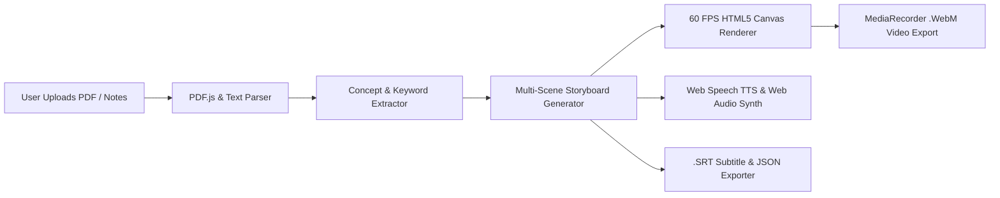

# StudyShorts Studio — 9:16 Vertical Study Reel Engine


**StudyShorts Studio** is a client-side web application that transforms uploaded lecture handouts (`.pdf`, `.txt`, `.md`) and raw study notes into **9:16 vertical revision videos** with kinetic word-by-word captions, animated technical diagrams, synchronized voiceover narration, and direct `.webm` video recording.

---

## System Architecture



## Key Engineering Highlights

- **Client-Side Document Parsing (`PDF.js`):** Extracts structured text directly from multi-page lecture PDFs in the browser without server round-trips.
- **Automated Storyboard Segmentation:** Splits dense academic text into a 6-part retention flow (*Hook*, *Core Definition*, *Step-by-Step Flowchart*, *Code/Formula Card*, *Exam Takeaway*, and *3-Second Rapid Quiz*).
- **60 FPS 9:16 Canvas Compositor:** Renders dynamic perspective grids, step flowcharts, terminal cards, and audio waveforms at `540x960` resolution using `requestAnimationFrame`.
- **Kinetic Word-Level Subtitle Sync:** Calculates real-time word indices against scene duration and speech rate (`0.85x–1.45x`) to highlight active words in creator-style caption blocks.
- **Zero-Backend `.WebM` Video Recording:** Captures the live canvas stream at 30 FPS via `canvas.captureStream()` and `MediaRecorder` to export playable vertical videos alongside `.srt` subtitle files.

---

## Quickstart (Local Development)

Because the application is self-contained with zero build steps required, you can run it immediately with any static file server:

```bash
# Clone the repository
git clone https://github.com/<your-username>/study-shorts-studio.git
cd study-shorts-studio

# Start a local server (Python 3)
python3 -m http.server 8080
```

Then open `http://localhost:8080` in your browser.

---

## Deployment

- **GitHub Pages:** Enabled automatically via `.github/workflows/deploy.yml` on every push to `main`.
- **Vercel / Netlify:** Import the repository with root directory `./` and no build command required.
